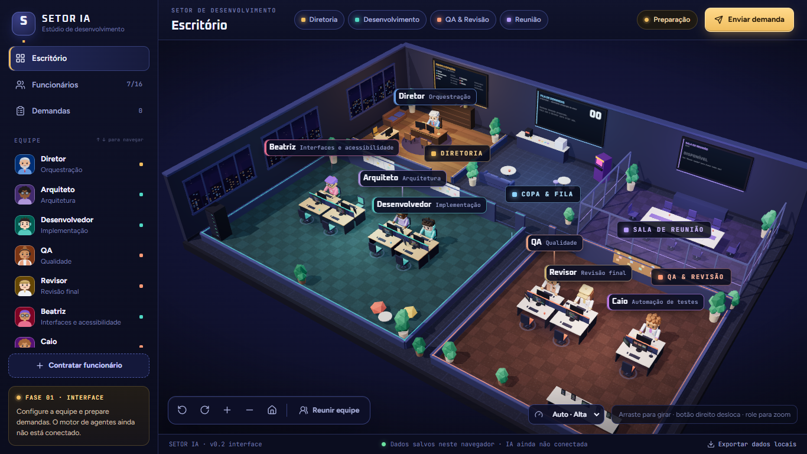

# Setor IA

Escritório 3D de uma equipe de colaboradores de IA (Diretor, Arquiteto, Desenvolvedor, QA e Revisor), que planeja, analisa, implementa, verifica e revisa demandas de software **neste computador**. Usa as suas assinaturas do Claude (Claude Code) e do ChatGPT (Codex CLI) e, opcionalmente, chaves de API.

**Fase atual: piloto local.** Nada roda sem uma confirmação sua. Cada envio a um colaborador é preparado, congelado e revisado por você. Com o piloto automático, você confirma uma política por plano, e o executor só envia o que ela permite. A execução real só funciona no servidor de desenvolvimento acessado por `localhost`; um build publicado mostra o motor como desativado.



## Fluxo

```
Demanda ─▶ Diretor (plano) ─▶ Arquiteto (análise, só leitura)
                            ─▶ Desenvolvedor (escrita numa cópia isolada → diff real)
                                 ─▶ Aplicar ao projeto local ─▶ Verificar entrega aplicada
                            ─▶ QA (operações do executor: leitura, verificações, navegador controlado)
                            ─▶ Revisor (parecer final, coerente com o QA)
```

- **Diretor**: planeja a demanda em etapas e tarefas, a partir do GitHub público, de uma cópia local ou de um **projeto local autorizado** (inclusive repositórios privados).
- **Arquiteto**: recebe só texto e não tem ferramentas. Separa o que **leu** do que **inferiu**. Pode pedir esclarecimentos, que você resolve respondendo ou indicando arquivos a ler.
- **Desenvolvedor**: só pela conexão Claude Code, com `--restricted`. Escreve numa cópia `git archive` do commit aprovado, dentro do escopo que **você** escolheu. O resultado é decidido pelo diff que o executor calcula, não pelo relato do modelo.
- **Aplicar e verificar**: o diff é aplicado depois de uma revisão do estado exato do projeto, com cópia de segurança e restauração em caso de falha. Depois, os comandos configurados do projeto rodam num ambiente isolado. Nada é commitado nem publicado.
- **QA**: o modelo não tem ferramentas. Ele pede operações de um catálogo fixo; o executor as roda numa cópia isolada da versão testada e devolve evidências numeradas. Cada critério precisa citar essas evidências.
- **Revisor**: reaproveita o que o QA recebeu e o parecer dele. O veredito (`aprovado`, `aprovado_com_ressalvas`, `reprovado`) não pode contradizer o QA.
- **Piloto automático (fase 1)**: em vez de aprovar envio por envio, você aprova **uma política** por plano. Ela congela as fichas, o orçamento total de tokens, o máximo de execuções e a validade. O executor então envia sozinho as tarefas do Arquiteto, do QA e do Revisor. Ele para e chama você nestes casos: esclarecimento, falha, cancelamento, orçamento, uso não informado, ficha divergente. O Desenvolvedor continua sempre com você.

Detalhes, garantias de segurança, casos reais e limites: **[docs/executor-local.md](docs/executor-local.md)**.

## Como rodar

Pré-requisitos:
- Node.js 22.13 ou mais novo;
- pnpm;
- pelo menos um cliente oficial instalado e com login: `claude auth login --claudeai` ou `codex login`.

```bash
pnpm install
```

Em um terminal, o executor local (na primeira vez ele cria `.dev.vars` com o token e a chave da máquina):

```bash
pnpm executor
```

Em outro terminal, a interface:

```bash
pnpm dev
```

Abra `http://localhost:5173`. Em seguida:
1. Na ficha de cada colaborador (aba Perfil), escolha a conexão.
2. Para trabalhar sobre um projeto da sua máquina, cadastre-o em **Configurações → Conexões de IA → Projetos locais** e salve a **configuração de execução** dele.
3. Crie uma demanda e clique em **Planejar com o Diretor**.

Se o `pnpm dev` já estava aberto antes do executor, reinicie-o para ele ler o token.

## Scripts

| Comando | O que faz |
|---|---|
| `pnpm dev` | interface (Vite/vinext, porta 5173) |
| `pnpm executor` | executor local (`127.0.0.1:4317`) |
| `pnpm test` | suíte Vitest (308 testes; usa Git, `tar` e Node reais, cerca de 5 min no Windows) |
| `pnpm lint` | ESLint |
| `pnpm check:clients` | detecção real dos clientes oficiais, sem chamar modelo |
| `pnpm check:readonly` | verificação real de que o modo somente leitura não escreve (uma chamada por cliente) |
| `pnpm check:developer-write` | verificação real do confinamento de escrita do Desenvolvedor (uma chamada) |
| `pnpm diagnose:run <id>` | composição do texto e uso informado de uma execução registrada |
| `pnpm build` | build do site (o motor fica desativado no build) |

## Estrutura

| Caminho | Conteúdo |
|---|---|
| `app/page.tsx`, `components/office/` | interface: cena 3D (`scene/`), painéis, fichas, diálogos de envio, aplicação e QA (`panels/`) |
| `hooks/` | estado do escritório (`use-office.ts`, `localStorage`) e das execuções (`use-runs.ts`) |
| `app/api/**`, `lib/server/` | rotas web: proxy para o executor, aceitas só em `localhost` |
| `executor/main.ts`, `lib/executor/` | executor local: fila, encaminhamentos, adaptadores, cópias isoladas, aplicação, ambiente do QA e registro em SQLite |
| `lib/engine/` | tipos, prompts e esquemas de cada colaborador, regras de dependência e estados (compartilhados com a interface) |
| `lib/office/` | fichas padrão, migração do armazenamento local, fase do produto |
| `tests/` | testes Vitest |
| `docs/` | documentação e capturas |

Dados locais, todos fora do Git:
- `.ayla/`: registro das execuções (`runs.sqlite`), artefatos do QA, cópias de segurança das aplicações e backups antes de cada migração;
- `.dev.vars`: token do executor, chave da máquina e `AYLA_LOCAL_REPOS`.

## Segurança, em resumo

- Nenhuma credencial de conta passa pelo Setor IA: os logins ficam com os clientes oficiais.
- O executor escuta só em `127.0.0.1`, exige token, recusa chamadas vindas de páginas web e nunca usa shell.
- Cada envio é congelado e confirmado pelo hash do conteúdo revisado.
- Somente leitura e escrita confinada foram verificadas com chamadas reais.
- O QA roda sem credenciais pessoais, e o navegador dele fica atrás de um guarda de rede que só deixa passar origens exatas.
- Limite conhecido: os comandos do próprio projeto não têm a rede isolada.

## Documentação

- [docs/executor-local.md](docs/executor-local.md): executor, colaboradores, projetos locais, aplicação, QA, Revisor, segurança, registro e estado atual.
- [docs/integracao-backend.md](docs/integracao-backend.md): dados locais, fichas e o contrato `DemandPayload` da fase de interface.
- [ASSETS.md](ASSETS.md): origem e licença dos recursos visuais.

## Base técnica

O projeto nasceu do starter [vinext](https://github.com/cloudflare/vinext) (Next.js sobre Vite, com Worker da Cloudflare), que continua sendo a base do build:
- `pnpm build` gera `dist/` e `npm start` roda o Worker localmente com Wrangler;
- `.openai/hosting.json` não declara ligações D1/R2 (ambas `null`). `db/` e `drizzle.config.ts` vêm do starter, mas o esquema está vazio: hoje os dados ficam no `localStorage` (interface) e no SQLite do executor;
- `.sites-runtime/`, `.wrangler/` e `.vinext/` são estado local descartável, ignorado pelo Git.

A versão hospedada não tem acesso aos logins deste computador. O caminho possível está descrito em “Publicação na Vercel” no [executor-local.md](docs/executor-local.md).
